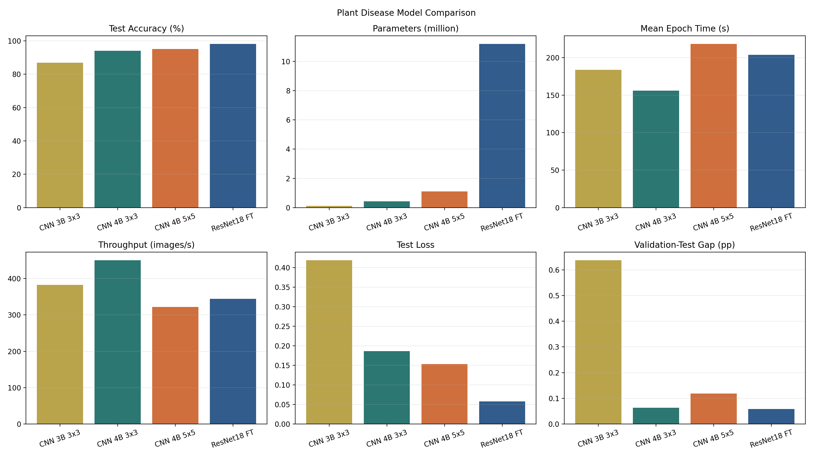

# 基于卷积神经网络的植物病害识别及网络结构参数对比研究

**正文版本：** 2026 年 6 月  

> 学校统一封面和个人信息待提交模板下发后添加。

## 摘要

本研究使用包含 38 类健康与病害叶片的图像数据集，自行搭建卷积神经网络，并控制其他
训练条件不变，比较卷积块数量和卷积核大小对分类准确率、参数量与训练效率的影响。
实验表明，4 卷积块 `3x3` 模型比 3 卷积块模型的测试准确率提高 7.13 个百分点；
在 4 卷积块结构中，`5x5` 卷积核比 `3x3` 提高 1.02 个百分点，但参数量增加到
2.61 倍。加载 ImageNet 预训练权重并微调全部网络的 ResNet18 测试准确率达到
98.12%，比自建 `4 blocks, 3x3` 提高 4.10 个百分点。结果说明足够的网络深度是
自建模型的关键因素，迁移学习能进一步提升准确率，但需要更多参数和计算资源。

## 1. 研究背景与问题

植物病害类别之间常具有相似颜色和纹理，仅依靠人工观察容易受经验影响。CNN 能从
图像中自动学习边缘、纹理、病斑形状和全局结构。本研究关注三个问题：网络深度是否
影响复杂病害特征的表达，更大卷积核的感受野能否改善分类效果，以及 ImageNet
预训练 ResNet18 相比自建 CNN 能否获得更好的准确率与泛化表现。

## 2. 方法

### 2.1 数据与控制变量

训练、验证和测试样本数分别为 70,295、8,790 和 8,782。Kaggle 原 `valid`
按类别和随机种子 42 固定拆分为验证集与独立测试集。所有模型使用 `224x224` 输入、
Batch Size 32、10 Epoch、Adam、学习率 0.001、相同数据增强和相同评价流程。

### 2.2 自建 CNN

自建模型由卷积、BatchNorm、ReLU、最大池化、自适应平均池化和全连接分类器组成。
结构实验分别改变卷积块数量和卷积核大小，其他训练条件保持一致。

### 2.3 ResNet18 迁移学习

ResNet18 使用 torchvision 官方 ImageNet 预训练权重，将原 1000 类全连接层替换为
38 类分类层，并对全部网络参数进行微调。残差连接让网络学习输入与目标特征之间的
残差映射，有助于缓解深层网络的优化困难。该组实验与自建 CNN 保持数据、输入尺寸、
Epoch、Batch Size、优化器和学习率一致，但由于使用外部预训练知识，应作为迁移学习
扩展单独解释，而不是普通的单变量结构对比。

## 3. 结果

| 模型 | 验证 Accuracy | 测试 Accuracy | 测试 Loss | 参数量 | 平均 Epoch | 吞吐量 |
| --- | ---: | ---: | ---: | ---: | ---: | ---: |
| 自建 CNN: 3 blocks, 3x3 | 87.53% | 86.89% | 0.4191 | 115,110 | 183.78 秒 | 382.44 张/秒 |
| 自建 CNN: 4 blocks, 3x3 | 93.96% | 94.02% | 0.1863 | 427,174 | 156.02 秒 | 450.47 张/秒 |
| 自建 CNN: 4 blocks, 5x5 | 95.16% | 95.05% | 0.1535 | 1,116,838 | 218.33 秒 | 321.90 张/秒 |
| ResNet18: ImageNet 全层微调 | 98.18% | 98.12% | 0.0576 | 11,196,006 | 203.75 秒 | 344.38 张/秒 |

## 4. 分析

增加第四个卷积块后，模型参数量增加，但测试准确率提高 7.13 个百分点，说明浅层模型
难以充分组合 38 类病害所需的高级特征。固定 4 个卷积块后，`5x5` 进一步提高
1.02 个百分点，可能因为更大感受野可以同时观察病斑和周围组织，但计算成本明显增加。

3 卷积块单次运行的实测时间没有比 4 卷积块更短，说明墙钟时间还受到数据读取、
多进程启动、GPU 状态和后台负载影响。参数量和准确率的结构结论较明确，效率结论需要
多次预热重复实验后再报告均值和标准差。

ResNet18 的测试准确率比自建 `4 blocks, 3x3` 提高 4.10 个百分点，测试 Loss 从
0.1863 降至 0.0576。主要原因是 ImageNet 预训练已经学习了边缘、纹理、形状等通用
视觉特征，植物病害训练只需在这些特征基础上适配叶片与病斑类别。ResNet18 参数量为
自建基线的 26.21 倍，平均每 Epoch 时间增加 30.59%，但仍比 `5x5` 自建 CNN 的
平均 Epoch 时间短。它的验证与测试准确率仅相差 0.059 个百分点，说明当前独立测试
划分上的泛化较稳定。

训练集准确率是在随机增强和训练态 Dropout 下逐批统计的，可能低于关闭增强后的验证
与测试准确率，因此本文不把最后一轮训练准确率直接解释为常规训练-测试泛化误差。
泛化分析主要使用独立测试结果及验证-测试差距。

## 5. 结论

在当前数据集上，网络深度不足造成的准确率损失大于卷积核大小带来的差异。4 卷积块
`3x3` 在准确率和参数量之间取得较好平衡；若更重视最高准确率且计算资源允许，可使用
ResNet18 迁移学习。自建 CNN 更适合讲解卷积过程和控制参数规模，ResNet18 则展示了
预训练知识与残差结构在准确率上的优势。最终模型选择应根据准确率、训练成本、模型
大小和教学解释需求共同决定。
